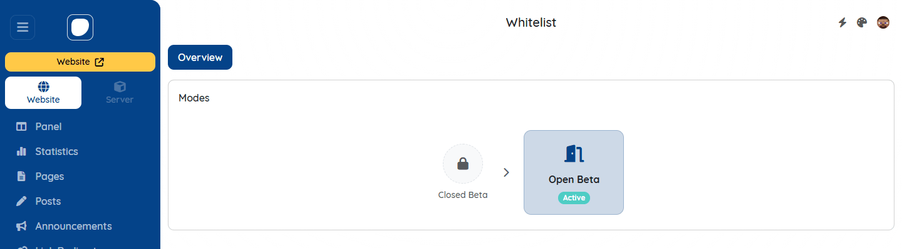

  <h1>Whitelist</h1>
  
<b>Run closed and open beta launches for your Minecraft server from your panel.</b>

  

    
  

Whitelist gives your panel a home for controlling who can join your server during a launch. It is an early preview: today it adds a Whitelist page to your panel that shows your launch modes, Closed Beta and Open Beta, and which one is active. More whitelist tools will arrive in future updates.

## ✨ Features
- 📜 **Whitelist page in your panel**: A dedicated spot in the panel menu, right next to your players.
- 🚦 **Launch modes**: See your Closed Beta and Open Beta stages side by side.
- ✅ **Active mode at a glance**: The current stage is highlighted so your team always knows where you are.
- 👥 **Staff permission**: Choose which staff members can open the whitelist.
- 🌐 **Translated**: Available in English, Turkish and Russian.

## 🚀 Get started
Whitelist is coming to the Pano store soon. Once it is there:

1. Open your Pano panel and go to **Addons**.
2. Find **Whitelist** and click **Install**.
3. Open **Whitelist** in the panel menu to see your launch modes.

## 💬 Support
Questions or ideas? Join our [Discord](https://panomc.com/discord) or visit [panomc.com](https://panomc.com).

## 📄 License
Released under the MIT License.
